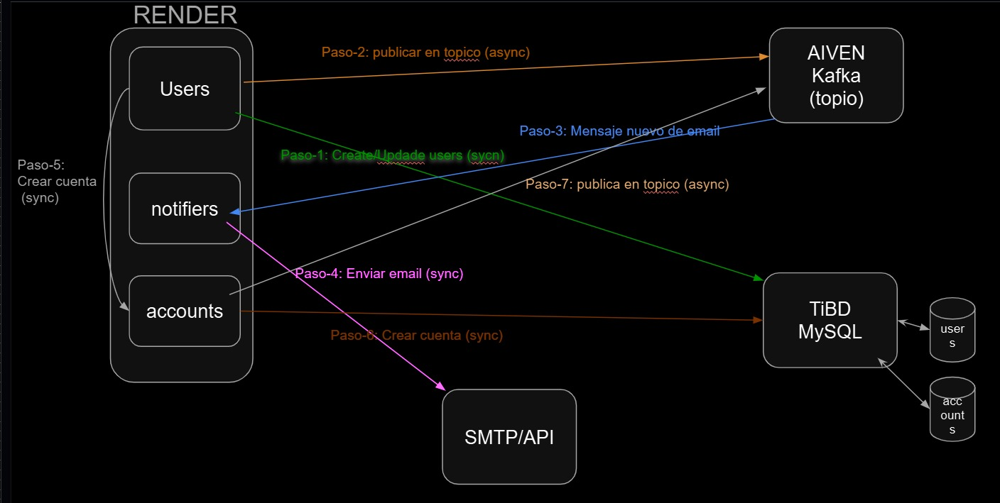
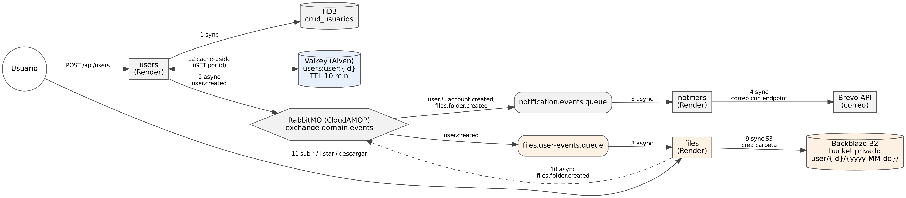

# Parcial de microservicios: comunicación síncrona y asíncrona con resiliencia

Fundación Universitaria Colombo Internacional (UNICOLOMBO) · Electiva · Décimo semestre
Docente: John Carlos Arrieta Arrieta

**Integrantes**

| Integrante | Microservicio |
|------------|---------------|
| Gabriel Enrique Carrillo Florez | `users` |
| Jesús Manuel Valiente Florez | `accounts` |
| Jefferson Arrieta Durán | `notifiers` |

**Taller (Guías 9 y 10):** Jesús Valiente — microservicio `files` (Backblaze B2) · Jefferson Arrieta —
correo con la ruta de la carpeta (`notifiers`) · Gabriel Carrillo — caché distribuida Valkey en `users`.



## Flujo

| Paso | Origen → destino | Tipo |
|------|------------------|------|
| 1 | users → TiDB (tabla `users`) | Síncrono |
| 2 | users → RabbitMQ (`user.created`, `user.updated`) | Asíncrono |
| 3 | RabbitMQ (`notification.events.queue`) → notifiers | Asíncrono |
| 4 | notifiers → Brevo (API REST) | Síncrono |
| 5 | users → accounts (`POST /api/accounts`) | Síncrono |
| 6 | accounts → TiDB (tabla `accounts`) | Síncrono |
| 7 | accounts → RabbitMQ (`account.created`) | Asíncrono |

## Taller: bucket de archivos y caché distribuida



| Paso | Origen → destino | Tipo |
|------|------------------|------|
| 8 | RabbitMQ (`files.user-events.queue`, `user.created`) → files | Asíncrono |
| 9 | files → Backblaze B2: crea `user/{userId}/{yyyy-MM-dd}/` | Síncrono (API S3) |
| 10 | files → RabbitMQ (`files.folder.created`) → notifiers → correo con el endpoint | Asíncrono |
| 11 | Usuario → files (`/api/files/users/{id}`): subir, listar, descargar (302 al bucket), eliminar | Síncrono |
| 12 | users ↔ Valkey (Aiven): `GET /api/users/{id}` con caché-aside, TTL e invalidación | Síncrono |

* **Guía 9 (Backblaze B2):** bucket privado; el microservicio valida que cada archivo pertenezca a
  la carpeta del usuario y entrega la descarga con una URL prefirmada de 10 minutos.
* **Guía 10 (Valkey):** clave `users:user:{id}` con TTL de 10 minutos; al actualizar o eliminar
  se borra la clave para que ninguna réplica lea datos viejos. Sin `VALKEY_URL` el servicio
  funciona sin caché.
* **Guía 11 (OpenSearch/CQRS):** opcional, no incluida.

## Estructura del repositorio

```
users/       Microservicio de usuarios (repositorio base del docente, arquitectura hexagonal)
accounts/    Microservicio de cuentas
notifiers/   Microservicio de notificaciones (envío de correos migrado desde users)
files/       Microservicio de archivos en Backblaze B2 (taller, Guía 9)
docs/        Diagramas del parcial y del taller
```

## Mensajería: RabbitMQ en CloudAMQP (patrón FanIn)

| Elemento | Valor |
|----------|-------|
| Exchange | `domain.events` (tipo `topic`, durable) |
| Cola | `notification.events.queue` (durable) |
| Bindings | `user.created`, `user.updated`, `account.created`, `files.folder.created` |
| Cola de files | `files.user-events.queue` (durable), binding `user.created` |

Formato del evento (igual al del *notification-service* del docente):

```json
{ "eventName": "user.created", "occurredOn": "2026-10-14T10:00:00", "payload": { "name": "...", "email": "..." } }
```

notifiers declara el exchange, la cola y los bindings al iniciar, por lo que coinciden con
los creados en CloudAMQP.

## Resiliencia

* users → accounts: timeout, retry, circuit breaker y fallback (Resilience4j).
* notifiers → Brevo: retry con backoff exponencial y circuit breaker (Resilience4j).
* Publicación en RabbitMQ: reintentos del `RabbitTemplate` y fallback que registra el error.
* Consumo en notifiers: reintentos del contenedor de Spring AMQP.

## Despliegue en Render

Un *Web Service* por microservicio desde este repositorio, con *Runtime* **Docker** y
*Root Directory* `users`, `accounts`, `notifiers` o `files`. notifiers y files deben permanecer activos para
consumir sus colas (en el plan gratuito, una tarea programada que consulte `/` cada 13 minutos).

| Servicio | Variables de entorno |
|----------|----------------------|
| users | `DB_HOST`, `DB_PORT`, `DB_NAME`, `DB_USERNAME`, `DB_PASSWORD`, `DB_SSL_MODE`, `JWT_SECRET`, `RABBITMQ_URL`, `ACCOUNTS_BASE_URL`, `VALKEY_URL` |
| accounts | `DB_HOST`, `DB_PORT`, `DB_NAME`, `DB_USERNAME`, `DB_PASSWORD`, `DB_SSL_MODE`, `RABBITMQ_URL` |
| notifiers | `RABBITMQ_URL`, `BREVO_API_KEY`, `BREVO_FROM_ADDRESS`, `BREVO_FROM_NAME` |
| files | `RABBITMQ_URL`, `B2_ENDPOINT`, `B2_REGION`, `B2_BUCKET`, `B2_KEY_ID`, `B2_APPLICATION_KEY`, `FILES_PUBLIC_URL` |
